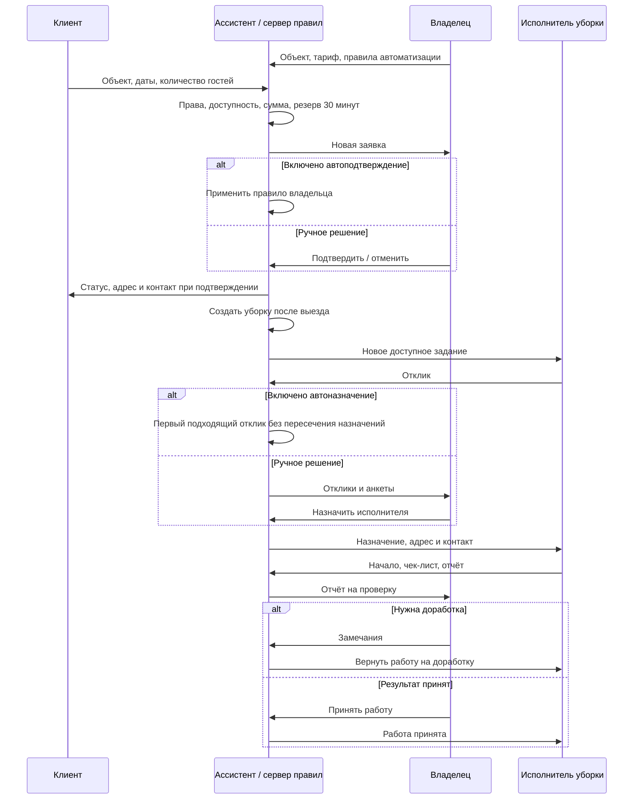

# Централизованный ассистент AI Аренда

## Модель продукта

У сервиса три кабинета: клиент, владелец недвижимости и исполнитель уборки. Каждый кабинет объединяет профиль, собственные заявки, результаты, историю событий и диалог с ассистентом. Один человек может явно подключить несколько ролей и переключать кабинеты; новая роль не выдаётся автоматически из произвольной фразы в чате.

Регистрация по email и паролю создаёт самостоятельную учётную запись и профиль выбранной роли в базе. При следующем входе восстанавливаются данные и последний выбранный кабинет. Пароли хранятся как scrypt-хэши с индивидуальной солью; сессии — как хэши случайных токенов. Cookies HttpOnly, SameSite=Lax, Secure на HTTPS; срок сессии 30 дней. Выход отзывает сессию. Ограничиваются попытки входа и регистрации. Это аутентификация аккаунта: проверка личности по документам, подтверждение email, SMS и восстановление пароля ещё не подключены.

## Три участника

| Кабинет | Собственные данные | Запрос | Результат |
|---|---|---|---|
| Клиент | Профиль, заявки и бронирования | Найти жильё, выбрать время, отправить заявку, отменить, сообщить о проблеме | Расчёт, статус, подтверждённые даты, адрес и контакт после подтверждения |
| Владелец | Объекты, заявки гостей, задания уборки, отклики, отчёты, правила автоматизации | Зарегистрировать объект, изменить условия, подтвердить бронь, назначить уборку, принять результат | Управляемое объявление, календарь без пересечений, подготовленный объект, история действий |
| Исполнитель уборки | Анкета, отклики, назначения, чек-листы, отчёты и принятые работы | Найти задание, откликнуться, отказаться до начала, начать работу, отправить результат | Назначение, адрес и контакт после назначения, статус приёмки и замечания |

Квартира, дом, отдельный гостиничный номер, место в хостеле или другой сдаваемый объект имеют собственный календарь. Для гостиниц и хостелов каждый сдаваемый номер/место регистрируется отдельно. У объекта выбирается тариф за час или за сутки. Сумма округляется вверх до начатого часа либо периода 24 часа; тариф фиксируется в бронировании. Изменение цены объявления не пересчитывает существующие брони.

## Общая цепочка

## Автоматизация

Ассистент — единый диспетчер событий. Сервер проверяет права, фактические записи и разрешённые переходы; языковая модель может помогать с формулировками, но не заменяет эти проверки.

Владелец явно включает два правила в своём кабинете:

1. **Автоподтверждение брони.** Доступная заявка подтверждается без отдельного нажатия владельца. Система сохраняет сумму, уведомляет участников и создаёт уборку с заданным вознаграждением.
2. **Автоназначение уборки.** Система обрабатывает зарегистрированные отклики по очереди. Проверяет актуальную роль исполнителя, город, статус задания и отсутствие пересечения с другими назначениями. Владелец может оставить ручной выбор.

Правила применяются к открытым и новым заявкам/откликам. Фоновый обработчик повторяет незавершённую автоматическую обработку. Блокировки календаря и конфликтов назначения проверяются также SQL-триггерами; повторные заявки клиента имеют ключ идемпотентности. Одна бронь создаёт максимум одну уборку.

Приёмка фактического качества и проверка поступления оплаты остаются у владельца. Сервис не заявляет о выполненной физической работе, заселении или банковском переводе только на основании текста пользователя.

## Исключения и уведомления

- Заявка без подтверждения за 30 минут истекает, резерв освобождается; уведомляются клиент и владелец.
- Перед заездом создаются напоминания клиенту и владельцу; после времени выезда — уведомление о завершении проживания и подготовке объекта.
- Новое задание доступно зарегистрированным исполнителям нужного города; адрес скрыт до назначения.
- Отклик уведомляет владельца. Назначенный исполнитель получает адрес, остальные — сообщение о выборе другого исполнителя.
- Исполнитель может отказаться до начала. Задание открывается заново; его предыдущий отклик помечается как отозванный. Владелец уведомляется, другие отклики снова могут быть обработаны.
- Начало уборки уведомляет владельца. Отчёт передаётся на приёмку; замечания возвращают задание в работу. После исправления нужен новый отчёт.
- При отмене брони отменяются ещё не начатые связанные уборки и уведомляется назначенный исполнитель. При уже начатой работе отмена требует отдельного урегулирования через обращение.
- Просроченная уборка создаёт уведомление владельцу и назначенному исполнителю. Ассистент не скрывает просрочку и не отмечает её выполненной самостоятельно.
- Уведомления дедуплицируются. Кабинет показывает непрочитанные события, отдельные оповещения и следующие действия. Журнал операций хранится в базе.

## Фоновая работа

В локальном режиме Vite запускает серверную проверку каждые 30 секунд. Открытая вкладка для неё не нужна; компьютер и сервер должны работать. Внутренний endpoint защищён случайным токеном, который хранится в игнорируемой `.sites-runtime/` и передаётся только серверу.

Для размещения подготовлен обработчик Cloudflare `scheduled`. Круглосуточный production-режим требует публикации и настройки Cron Trigger для этого обработчика; в рамках локальной доработки облачная публикация и расписание не создавались. Обновление интерфейса каждые 30 секунд отвечает только за показ новых данных и не является фоновым диспетчером.

## Состояние реализации

Реализованы отдельные аккаунты и кабинеты, роли, типы недвижимости, почасовой/суточный расчёт, заявки, опциональные автоматические подтверждения и назначения, уведомления, фоновые проверки, отказ до начала, доработка и приёмка отчётов.

Свободная языковая модель требует настроенного ключа и согласия на передачу сообщений; текущий интерфейс работает как алгоритмический ассистент. Фото, банковские платежи, внешние мессенджеры, документальная идентификация и recovery-процедуры пока не подключены. Принятая работа в кабинете исполнителя не означает фактическую выплату. Полная готовность объекта подтверждается фактической приёмкой владельца.

Проверки: изоляция трёх участников, полномочия, сессии и выход, хэширование паролей, часовой расчёт, конфликты календаря, автоматическая цепочка брони и уборки, повторная фоновая обработка, дедупликация, отказ исполнителя, доработка отчёта и приёмка. Тестовые аккаунты локальной проверки не являются аккаунтами реальных участников.
